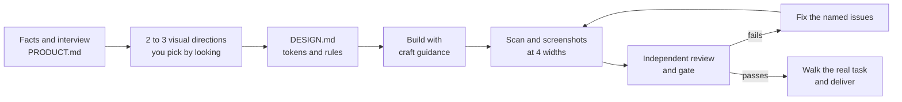

# Tailored

**Interfaces that look designed for their product, not generated for any product.**

English · [繁體中文](README.zh-TW.md)

Tailored is an Agent Skill for Codex, Claude Code and other agents that support skills. It turns an AI coding agent into a careful product designer for websites, web apps, admin consoles, dashboards, mobile apps and AI products. Here is what it does:

- It learns the product before touching pixels.
- It builds two or three real, clickable visual directions and lets you pick by looking.
- It implements the chosen one with concrete craft rules.
- It sends the result through an AI-slop scanner, an independent reviewer and a gate until it passes.

## Why

AI-made interfaces are rarely broken. They are average. With little context, every decision falls back to the most common choice:
- a purple gradient or a dark glass console with glowing buttons;
- three identical feature cards;
- tiny grey labels everywhere;
- numbers nobody can source.

Loading more design skills doesn't fix it, and asking the user "what colors do you like?" doesn't either. Most people can't describe a palette, but they know immediately when they see one that's wrong.

Tailored is built around that:

- **Aim for an award, not for "clean".** The default bar is an Awwwards Site of the Day. Awwwards scores design at 40% and creativity at 20%, so tidy and error-free only earns half the points. Every direction starts from a concept taken from the product's own world, and that concept drives everything:
  - typography as the main visual;
  - a visible grid;
  - imagery or code-drawn visuals that belong to the concept;
  - choreographed motion.

  Before designing, the agent studies three to five recent winners and notes what to borrow.
- **Taste you can follow.** Concrete craft guidance covers layout and spacing, Traditional Chinese and Latin typography, how to build a palette, buttons, forms, tables, empty states, motion and interface copy. The key rule: spend your boldness in one place.
- **Choose by looking, not by questionnaire.** The interview asks only about facts: who uses it, the main task, what exists and what doesn't. Visual style is decided by comparing two or three directions built as real HTML with the same content, side by side, at desktop and phone width.
- **Skeletons for each kind of screen.** Separate guidance for websites, work consoles and admin tools, dashboards, mobile apps and PWAs, and desktop tools.
- **AI products done right.** Model playgrounds, chat, streaming answers you can stop, agent progress, API keys, usage logs and service status. These are the screens where generic AI design shows the most.
- **Review that can't be talked around.** Every round follows the same steps:
  - capture screenshots at four widths and run a static and on-screen scan for AI-slop patterns;
  - have a fresh reviewer with no design history score four principles (matches expectations, clear hierarchy, restraint, tailored) and run three tests (three-second, name-swap, core task);
  - pass a scripted gate. P0 and P1 issues block it, and only you can waive them.
- **No fake data, no fake success.** Numbers, customers and reviews must have a source. Buttons need real destinations. Translations change labels, never field codes. Before delivery, the agent actually walks through the core task.

## How it works



Modes keep the cost proportional:

| Mode | Use it for |
|---|---|
| Full design | New products, full redesigns, public-facing pages |
| New screen | Adding a page when PRODUCT.md and DESIGN.md already exist |
| Review | Checking or fixing an existing interface |
| Small fix | A clear, local change: fix, screenshot the affected part, verify |

When you ask the agent to "just finish it", it still builds the directions, completes the main one, and asks you to choose at delivery.

## Quick start

```sh
# Codex
git clone https://github.com/owen4sure/tailored ~/.codex/skills/tailored
# Claude Code
git clone https://github.com/owen4sure/tailored ~/.claude/skills/tailored
```

Then ask:

```text
Use tailored to design the model playground page for our in-house AI platform.
```

```text
Use tailored to review this dashboard. It looks generic and I want it fixed until it passes.
```

## What you'll see

| File | What it holds |
|---|---|
| `PRODUCT.md` | Who uses it, the main task, what exists and what doesn't, sourced numbers, no-go zones |
| `DESIGN.md` | The chosen direction in your own words, color tokens, type scale, spacing, component rules, the one bold element |
| `design-review/round-N/` | Screenshots, `scan.json`, `review.json`, `fixes.md` and a plain-language `report.md` |
| A comparison page | The directions side by side, switchable between desktop and phone widths |

When you react with "make it bolder", "quieter", "more professional" or "too crowded", the skill maps each phrase to specific changes instead of starting over.

## Scripts

Python 3. Screenshots and on-screen checks use Playwright; without it, the scanner falls back to static checks.

```sh
python3 scripts/loop.py init design-review --mode full --target http://localhost:3000
python3 scripts/scan.py --url http://localhost:3000 --src ./src --widths 1440,1024,768,390 --out design-review/round-1
python3 scripts/loop.py brief design-review   # prompt for the independent reviewer
python3 scripts/loop.py gate design-review    # 0 pass, 1 fail, 2 incomplete review, 3 stop and ask
python3 scripts/roll.py "tool shed" "lab notebook" "departure board"   # pick the main direction by chance
python3 tests/test_tailored.py
```

The scanner flags candidates, it doesn't hand down verdicts. A passed gate means no known violations, not that you'll like it. That is why you choose the direction yourself.

## When to use it

**A good fit:**

- New products, redesigns, and pages that people will use every day or judge at first sight.
- Admin consoles, internal tools and AI platforms that work but look generic.
- Checking an AI-built frontend before it ships.

**Not a fit:**

- Pure backend work.
- Copywriting on its own.
- Slide decks and document layout.
- Logos, illustration and generated imagery.

## Good to know

- The skill text is written in Traditional Chinese (Taiwan). Agents follow it whatever language you work in. Its typography guidance covers Traditional Chinese specifically: no italics or letter-spacing, and readable line height and line length.
- On shared or company machines, run the scanner with `--no-install` so it never installs anything without asking.
- The AI-slop rule table will age. New patterns are judged against the four principles and added to the table with a version bump (see `FROZEN.md`).

## Repository layout

```text
SKILL.md                    the workflow the agent follows
references/
  craft.md                  the floor: layout, type, color, components, motion, copy
  art-direction.md          the ceiling: how award-winning sites work, concept, type, grid, imagery, motion
  aesthetics.md             why winners look good: one theme world, extreme type, few bold colors, rhythm
  motion.md                 motion picked from the theme's verbs, so every theme moves differently
  details.md                measured details from 67 winners and 17 product UIs, plus a 2x zoom check
  systems.md                company systems, back offices, ERP and AI platforms: precision, not spectacle
  typography.md             choosing Traditional Chinese and Latin fonts by situation, with a specimen template
  platforms.md              websites, consoles, dashboards, mobile, desktop
  ai-products.md            playgrounds, chat, agents, keys, usage, status
  product.md                interview and PRODUCT.md
  directions.md             metaphors, dice, building directions, tuning phrases, DESIGN.md
  real-data.md              real workflows, data and translation boundaries
  principles.md             the four principles with scoring anchors
  antipatterns.md           the AI-slop rule table
  review-rubric.md          reviewer prompt, three tests, review.json, real-task checks
  checklist.md              pre-delivery checklist
  lessons.md                the real incidents behind the rules
templates/                  PRODUCT.md, DESIGN.md, comparison page, type specimen
scripts/                    scanner, review loop and gate, dice, rule table, punctuation check
tests/                      regression tests and fixtures
evals/                      behavior scenarios
```

## Acknowledgements

Tailored rewrites and combines ideas from:
- [Matt Pocock's grilling](https://github.com/mattpocock/skills) (MIT)
- [taste-skill](https://github.com/Leonxlnx/taste-skill) (MIT)
- [OpenDesign](https://github.com/nexu-io/open-design) (Apache-2.0)
- [UI UX Pro Max](https://github.com/nextlevelbuilder/ui-ux-pro-max-skill) (MIT)
- [Anthropic's frontend-design](https://github.com/anthropics/skills/tree/main/skills/frontend-design) (Apache-2.0)
- [Impeccable](https://github.com/pbakaus/impeccable) (Apache-2.0)

It also merges the author's own design-review-loop skill, with its scanner, gate and tests. No upstream files or text were copied. What each source contributed is listed in [references/sources.md](references/sources.md), and license notices are kept in [THIRD_PARTY_NOTICES.md](THIRD_PARTY_NOTICES.md), [NOTICE](NOTICE) and `licenses/`.

## License

[Apache-2.0](LICENSE)
