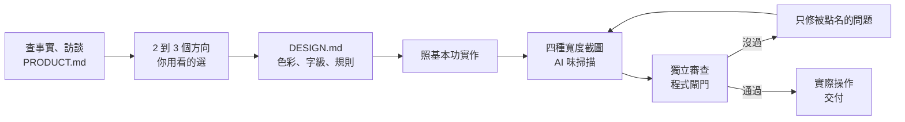

# Tailored

**為這個產品量身打造的介面，而不是對任何產品都適用的 AI 平均值。**

[English](README.md) · 繁體中文

Tailored 是一個 Agent Skill，適用於 Codex、Claude Code 和其他支援 skill 的 agent。它讓 AI 像一位細心的產品設計師，做網站、網頁應用、後台與工作台、儀表板、手機 App 和 AI 產品：

- 先搞懂產品，再動手。
- 做出 2 到 3 個真的能點的視覺方向，讓你用看的選。
- 照具體的基本功把選中的方向做出來。
- 再經過 AI 味掃描、獨立審查與程式閘門，修到過關為止。

## 為什麼需要它

AI 做的介面很少是壞的，問題是太普通。只要上下文不夠，每個決定都會退回最常見的選擇：
- 紫藍漸層，或深色玻璃卡配發光按鈕；
- 三張一樣大的功能卡；
- 到處都是小灰字；
- 說不出出處的數字。

多載入幾個設計 skill 解決不了這個問題，問使用者「喜歡什麼顏色」也一樣。大部分人說不出想要的配色，但看到畫面時，馬上就知道哪裡不對。

Tailored 就是照這個事實設計的：

- **目標是得獎，不是「乾淨」**：預設水準是 Awwwards 的當日最佳網站。Awwwards 的評分裡設計佔 40%、創意佔 20%，所以只做到整齊、不出錯，最多拿一半分數。每個方向都從產品自己的世界找一個概念，由概念帶出整個畫面：
  - 字體當主角；
  - 格線看得見；
  - 影像或用程式畫的視覺都跟概念有關；
  - 動態經過編排。

  動手前，agent 會先研究 3 到 5 個最近的得獎作品，寫下要借什麼。
- **說得出來的品味**：版面與間距、繁體中文與西文字體、配色怎麼建構、按鈕、表單、表格、空狀態、動效、介面文字，都有具體做法。最重要的一條：大膽的地方只留一處。
- **用看的選，不用問卷**：訪談只問事實，例如誰在用、最想完成什麼、有哪些功能、沒有哪些功能。視覺風格則是做出 2 到 3 個同內容的真實 HTML 方向，在同一頁切換桌機和手機寬度比較。
- **每種畫面都有骨架**：網站、工作台與後台、儀表板、手機 App 與 PWA、桌機工具，各有不同的起手方式。
- **AI 產品的畫面**：模型試用、聊天、可以隨時停止的逐字回答、agent 進度、金鑰、用量紀錄、服務狀態。這些正是最容易做成 AI 味的地方。
- **繞不過去的審查**：每一回合都照同一套做：
  - 在四種寬度截圖，加上靜態與畫面上的 AI 味掃描；
  - 由完全沒參與設計的審查者，依四原則（符合預期、主次分明、克制、量身打造）打分，並做三項測試（三秒、換名、核心任務）；
  - 最後經過程式閘門。P0、P1 問題會擋住過關，而且只有你能豁免。
- **不造假**：數字、客戶、評價都要有出處；每個按鈕都要有真的目的地；翻譯只改顯示文字，不動欄位代碼。交付前一定實際走過一遍核心任務。

## 怎麼運作



依情況選模式，成本才不會浪費：

| 模式 | 什麼時候用 |
|---|---|
| 完整設計 | 新產品、全面改版、對外門面 |
| 新畫面 | 已有 PRODUCT.md 與 DESIGN.md，要加一頁 |
| 審查 | 檢查或修好既有的介面 |
| 小修 | 明確的局部修改：改完截圖確認受影響的地方 |

你說「直接做完」時，它仍會做出幾個方向，用主方向完成，交付時再請你選。

## 快速開始

```sh
# Codex
git clone https://github.com/owen4sure/tailored ~/.codex/skills/tailored
# Claude Code
git clone https://github.com/owen4sure/tailored ~/.claude/skills/tailored
```

接著這樣說：

```text
使用 tailored 設計公司內部 AI 平台的「模型試用」頁。
```

```text
使用 tailored 審查這個儀表板，看起來很普通，幫我修到過關。
```

## 你會看到什麼

| 檔案 | 內容 |
|---|---|
| `PRODUCT.md` | 誰在用、首要任務、有和沒有的功能、有出處的數據、禁區 |
| `DESIGN.md` | 你選的方向（用你自己的話記錄）、色彩 token、字級、間距、元件規則、唯一大膽的地方 |
| `design-review/round-N/` | 截圖、`scan.json`、`review.json`、`fixes.md`，以及白話的 `report.md` |
| 方向比較頁 | 幾個方向並排，可以切換桌機和手機寬度 |

看完你說「再大膽一點」「再安靜一點」「再專業一點」「太擠了」，它會把每句話轉成具體的改法，不會整個重做。

## 程式

需要 Python 3。截圖與畫面檢查用 Playwright；沒有的話，掃描會退回只做靜態檢查。

```sh
python3 scripts/loop.py init design-review --mode full --target http://localhost:3000
python3 scripts/scan.py --url http://localhost:3000 --src ./src --widths 1440,1024,768,390 --out design-review/round-1
python3 scripts/loop.py brief design-review   # 產生給獨立審查者的提示詞
python3 scripts/loop.py gate design-review    # 0 通過、1 未通過、2 審查不完整、3 停下來問你
python3 scripts/roll.py 工具間 實驗紀錄本 航班看板   # 擲骰選主方向
python3 tests/test_tailored.py
```

掃描結果只是候選，不是判決。閘門通過代表沒有已知的問題，不代表你一定喜歡，所以方向要由你親自選。

## 適合什麼專案

**適合：**

- 新產品、改版，以及每天要用、或第一眼就會被評價的頁面。
- 能用但看起來很普通的後台、內部工具與 AI 平台。
- 用 AI 做完的前端，上線前的驗收。

**不適合：**

- 純後端。
- 只寫文案。
- 簡報與文件排版。
- logo、插畫與 AI 生成圖片。

## 使用須知

- skill 內容以繁體中文撰寫，不論你用什麼語言工作，agent 都能照著做。字體的部分特別寫了繁體中文排版：不用斜體、不拉字距，行高與行長都有建議範圍。
- 在公司或共用主機上執行掃描時，加上 `--no-install`，就不會在沒問你的情況下自動安裝任何東西。
- AI 味規則表會隨著時間過期。遇到新套路時，用四原則判斷，再補進規則表並升版本（見 `FROZEN.md`）。

## 檔案結構

```text
SKILL.md                    agent 依循的完整流程
references/
  craft.md                  底線：版面、字體、色彩、元件、動效、介面文字
  art-direction.md          天花板：得獎作品的做法、概念、字體、格線、影像、動態
  aesthetics.md             美感：主題世界、極端的字級、少而大膽的顏色、節奏
  motion.md                 依主題的動詞挑動態，每個主題動起來都不一樣
  details.md                量了 67 個得獎網站與 17 個產品介面的細節，加上放大檢查
  systems.md                公司系統、後台、ERP、AI 平台：美感來自精準，不是表演
  typography.md             依情況選中文與西文字體，附字體樣張範本
  platforms.md              網站、工作台、儀表板、手機、桌機
  ai-products.md            模型試用、聊天、agent、金鑰、用量、狀態
  product.md                訪談與 PRODUCT.md
  directions.md             隱喻、擲骰、做方向、調整指令、DESIGN.md
  real-data.md              真實流程、資料與翻譯的界線
  principles.md             四原則與評分錨點
  antipatterns.md           AI 味規則表
  review-rubric.md          審查提示詞、三項測試、review.json、實際操作驗證
  checklist.md              交付前檢查清單
  lessons.md                每條規則背後的真實事故
templates/                  PRODUCT.md、DESIGN.md、方向比較頁、字體樣張
scripts/                    掃描、審查迴圈與閘門、擲骰、規則表、標點檢查
tests/                      回歸測試與測試頁面
evals/                      行為評估情境
```

## 致謝

Tailored 改寫並整合了以下來源的做法：
- [Matt Pocock 的 grilling](https://github.com/mattpocock/skills)（MIT）
- [taste-skill](https://github.com/Leonxlnx/taste-skill)（MIT）
- [OpenDesign](https://github.com/nexu-io/open-design)（Apache-2.0）
- [UI UX Pro Max](https://github.com/nextlevelbuilder/ui-ux-pro-max-skill)（MIT）
- [Anthropic 的 frontend-design](https://github.com/anthropics/skills/tree/main/skills/frontend-design)（Apache-2.0）
- [Impeccable](https://github.com/pbakaus/impeccable)（Apache-2.0）

另外也合併了作者自己的 design-review-loop skill，包含它的掃描程式、閘門與測試。本專案沒有複製上述任何來源的檔案或文字。每個來源借用了什麼，詳見 [references/sources.md](references/sources.md)；授權聲明保留在 [THIRD_PARTY_NOTICES.md](THIRD_PARTY_NOTICES.md)、[NOTICE](NOTICE) 和 `licenses/`。

## 授權

[Apache-2.0](LICENSE)
